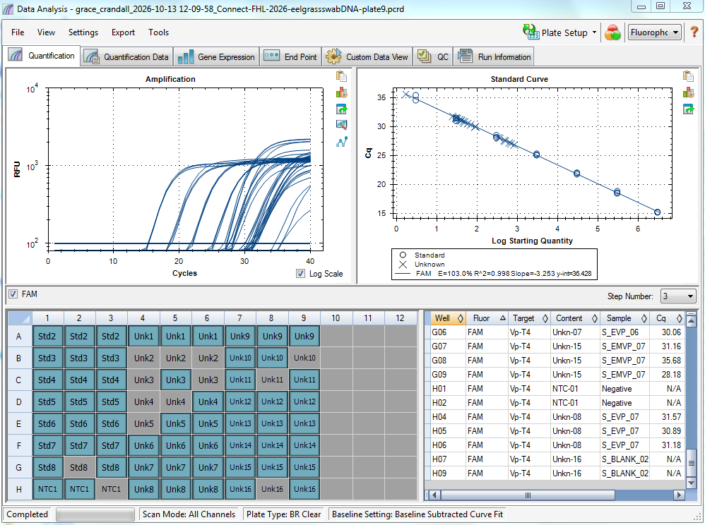

Ran the last remaining eelgrass swab DNA from FHL 2026 on qPCR targeting _Vibrio pectenicida_. See post for details. 

# qPCR Plate 9 Info
Plate Map: samples [here](https://docs.google.com/spreadsheets/d/1FoNawtO5tQ7sfmBsaRX9e62d3BHzk36l/edit?usp=sharing&ouid=109180173241522173082&rtpof=true&sd=true)

|                 |   |              | Each Mix |
|-----------------|---|--------------|----------|
| Ingredient      |   | per 20ul rxn |       72 |
| Mix             |   |           10 |      792 |
| 10X Exo IPC Mix |   |            2 |      158 |
| 50 Exo IPC DNA  |   |          0.4 |       32 |
| VPT4-F (10 um)  |   |          0.2 |       16 |
| VpT4-R (10 um)  |   |          0.2 |       16 |
| Probe (10 um)   |   |          0.2 |       16 |
| H20             |   |          4.5 |      356 |
| BSA             |   |          0.5 |       40 |
| Template        |   |            2 |          |
| Total           |   |           20 |     1426 |

# Plate 9 qPCR Run Results: 
[here](https://drive.google.com/drive/folders/1AF7wBehVytwnlws8s0rKdsDx61v2jlk5)

# Notes: 
I need to do the following things before I can run another plate: 
- Redilute more of the standard curve      
- Re-aliquot/dilute the forward and reverse primers     
- Re-aliquot/dilute the probe       
- THERE ARE NO MORE P10 TIPS!!! I don't have any funding... So I'll need to ask Steven if there are lab funds for lab supplies for everyone.... ? 

# Results plots
See current results post! 

