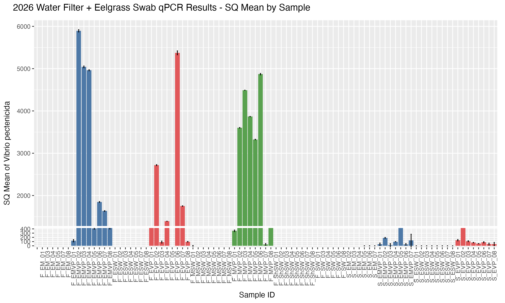
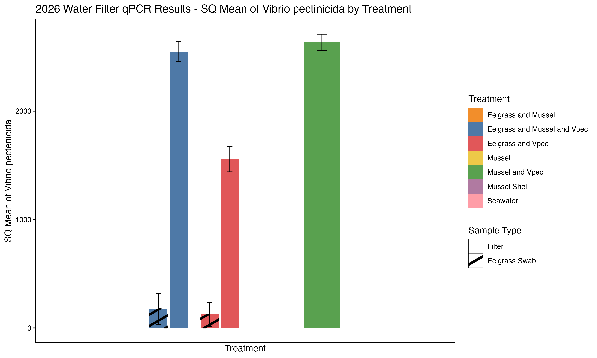
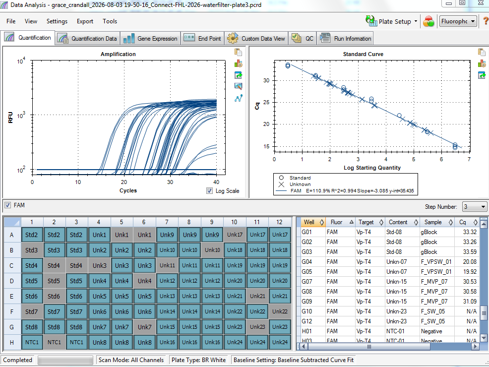

See post for the current up-to-date qPCR results for FHL 2026 experiment. 

# Updated FHL 2026 Sample Results: 

All cleaned/filtered updated qPCR data lives in [this google sheet](https://docs.google.com/spreadsheets/d/1RK9f18Qx6VD1uP2a8tud-LM3BKjWmHJdVwncZ_6WsIA/edit?usp=sharing)   

Method for working with the qPCR data:    
1. Set the threshold to 100.    
2. Remove from analysis any wells that aren't curves.    
3. With the final data, calculate the standard error and coefficient of variation for each sample and treatment.  
4. Update result plots.   

# Current result plots:   

For all plots, the error bars are the coefficent of variance. For the sample, it's that of the replicates run for each sample. For the treatments, it's that of all samples in that treatment. 

## By sample    

## By treatment 

# qPCR all plates stats

[all plates stats](https://docs.google.com/spreadsheets/d/1rv_RNMM6VxcZrRg9ZNHw4BjEnzVY0p44TxWQvBVZwJc/edit?usp=sharing)   

All look good except plate 3, which had really bad standard curves... 

All the greyed out boxes are wells that had no amplification. Sample plate map: [here](https://docs.google.com/spreadsheets/d/1SmJTY4UxzaR6oG__fQ2g7A5G8q3QklQE/edit?gid=375170068#gid=375170068)

# To Dos
There's a couple random samples that need to be run still.   

There's also a whole plate that I think might need to be re-run because the plate had REALLY bad standard curve (plate 3 mentioned above). 

I need to extract DNA from all the mussel tissues from 2026 and run those on qPCR. 

I also need to run all the mussel shell swab DNA (n=40 samples). 

Stay tuned... 

