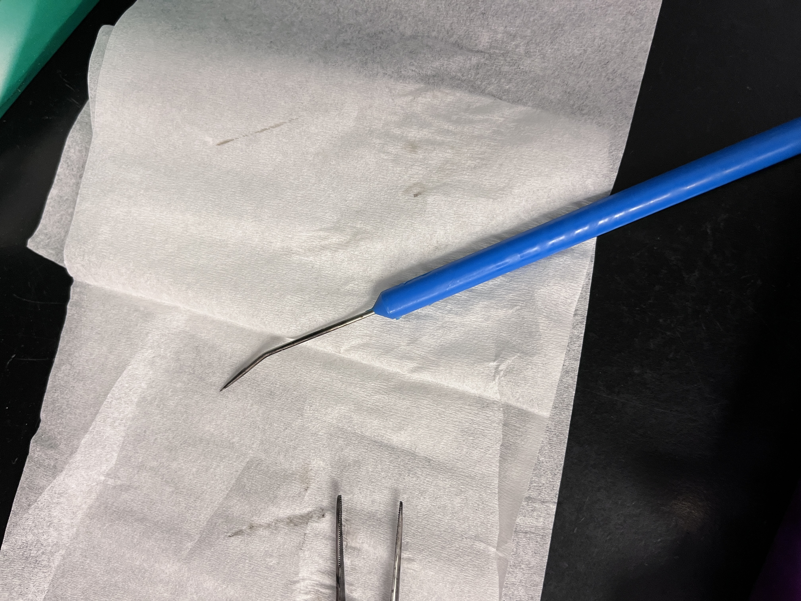
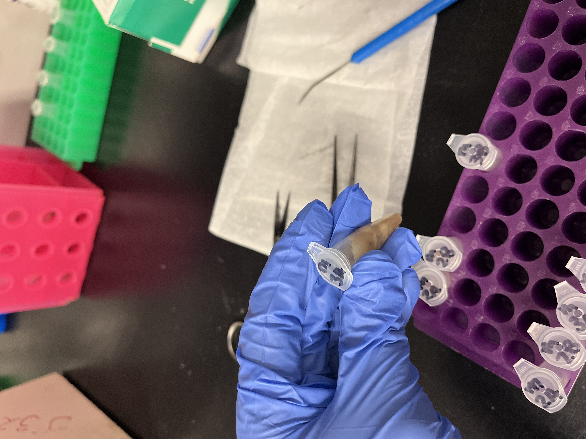
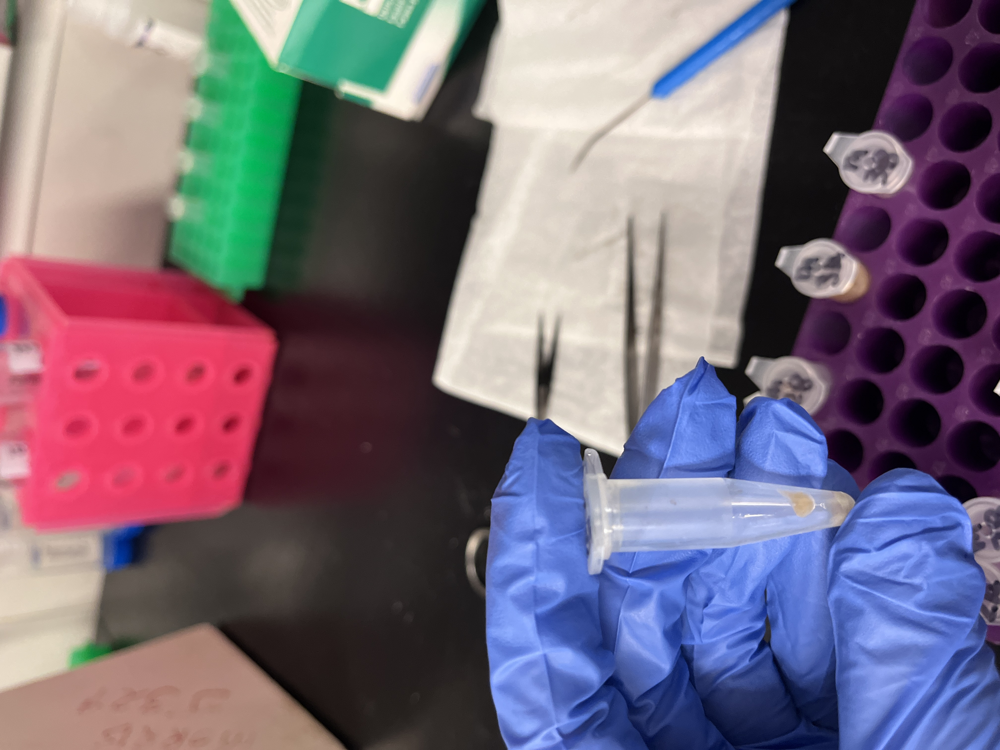
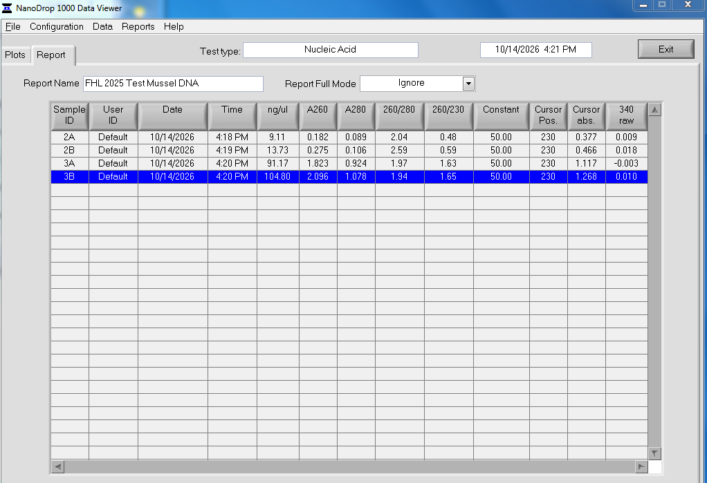

Notes on protocol and process in post. Testing again with correct mussel tissue weights. 

# Why am I doing this again? 

Well... it turns out I messed up the decimals when I was weighing my tissue during the [first FHL 2025 mussel tissue DNA extraction test](https://grace-ac.github.io/mussel2025-dna/), and was testing out 100mg, 150mg, 200mg, and 250mg of tissue instead of 10mg, 15mg, 20mg, and 25mg. So I am re-doing the test with the correct weights.

GitHub Issue with response from SR: [#2507](https://github.com/RobertsLab/resources/issues/2507)

# Kit and Protocol Notes:
Extraction performed 2026-10-13

Protocol notes: [here](https://docs.google.com/document/d/1juGroa-ubpDF-hYmn4hHuXhtTBuUJqUBvFeKoWbqe7U/edit?tab=t.wiwke8hrs35u)

The kit reagents that I got from Olivia Graham is missing extra Proteinase K, so a previous [notebook post](https://grace-ac.github.io/proteinaseKnotes/) explains that I can use the proteinase K from old Zymo kits, so long as it's in the correct concentration (20mg/mL). 

I looked back at the Zymo Quick DNA/RNA Microprep Plus Kit (D7005) protocol and saw that the aliquots I made for that kit are in the correct concentration (20mg/mL). So I am using those moving forward. I have a bunch aliquoted out! Stored in the FTR 213 freezer. 

# Samples Extracted
I grabbed 4 mussels from the 2025 FHL pilot experiment that were not actually from the experiment at all... but were exposed to _Vibrio pectenicida_ for a couple days. 

The samples are: 

M2A; M2B; M3A; M3B

| Sample ID | Weight (mg) | Actual Weight (g) |
|-----------|-------------|--------------------|
| M2A       | 10          |             0.0114 |
| M2B       | 15          |             0.0161 |
| M3A       | 20          |             0.0219 |
| M3B       | 25          |             0.0253 |

To sample the tissue, for each sample, I dissected out the whole mussel body and placed into a clean 1.5ml tube. I then used a dissection tool (pictured below) to mash up the tissue in the tube... I then used sterile tweezers and scissors to measure out the desired weights... is there a better way to do this?? It's such small tissue weight. See pictures below. 

dissecting tool i used to mash up the tissue:    

    

each mussel tissue sample looked like this (whole body) after mashing it up with the tool:     

   

each tissue subsample weighed to the correct weights were reallllyyyyy tiny samples, like this one:   

# Qubit and Nanodrop results: 

## Qubit

Using the Invitrogen Qubit 1X dsDNA HS Kit [protocol](https://drive.usercontent.google.com/download?id=13Re9y-ouOwMBTgPn1kiNKNEtdSf20ytQ&acrobatPromotionSource=gdrive_chrome-list&gdriveEmail=true#authuser=0&gdriveEmail=graceac9%40uw.edu). 

Letting the reagents thaw to room temp for 30 mins. Letting the DNA thaw to room temp as well. 

Running 2ul of each sample, so the math is:  

Standard 1 --> 10ul of standard 1 + 190ul of working solution    
Standard 2 --> 10ul of standard 2 + 190ul of working solution    
Sample 2A  --> 2ul of sample + 198ul of working solution    
Sample 2B --> 2ul of sample + 198ul of working solution    
Sample 3A --> 2ul of sample + 198ul of working solution    
Sample 3B --> 2ul of sample + 198ul of working solution    

Re-ran 3A and 3B with new standards with 1ul of sample:    
Standard 1 --> 10ul of standard 1 + 190ul of working solution       
Standard 2 --> 10ul of standard 2 + 190ul of working solution   
Sample 3A --> 1ul of sample + 199ul of working solution        
Sample 3B --> 1ul of sample + 199ul of working solution 

## Nanodrop
Ran 2ul of each sample on the nanodrop. 

Goal is to have "Nanodrop is still useful for the purity ratios. Look at 260/280 (target about 1.8) and 260/230 (target about 2.0 to 2.2). A low 260/230 would point to carryover"

# All Results:     

| Sample ID | Actual Weight (mg) | ul of Sample run on qubit | Std 1 | Std 2   | Qubit dsDNA HS (ng/ul) | nanodrop 260/280 (2ul ran) | nanodrop 260/230 (2ul ran)  |
|-----------|--------------------|---------------------------|-------|---------|------------------------|----------------------------|-----------------------------|
| M2A       |             0.0114 | 2                         | 71.26 | 20247.2 |                   3.88 | 2.04                       | 0.48                        |
| M2B       |             0.0161 | 2                         | 71.26 | 20247.2 |                   6.87 | 2.59                       | 0.59                        |
| M3A       |             0.0219 | 1                         | 83.57 | 24344.3 |                   95.8 | 1.97                       | 1.63                        |
| M3B       |             0.0253 | 1                         | 83.57 | 24344.3 |                    102 | 1.94                       | 1.65                        |

"Look at 260/280 (target about 1.8) and 260/230 (target about 2.0 to 2.2). A low 260/230 would point to carryover"

None of these fit the targets for the nanodrop values....  

# For my actual samples:
I have n=32 samples from the actual FHL 2026 Experiment (experiment info [here](https://grace-ac.github.io/FHL2026_expt/)). 

