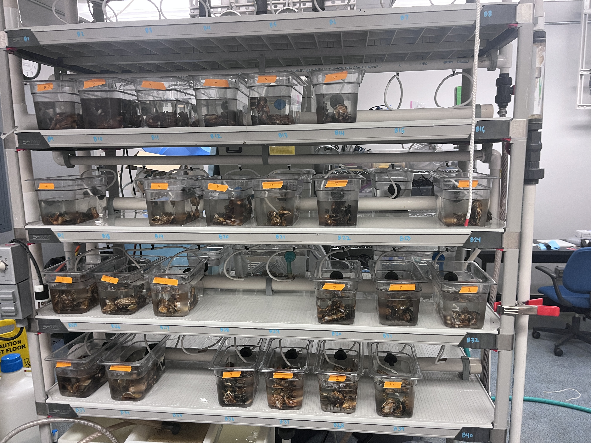
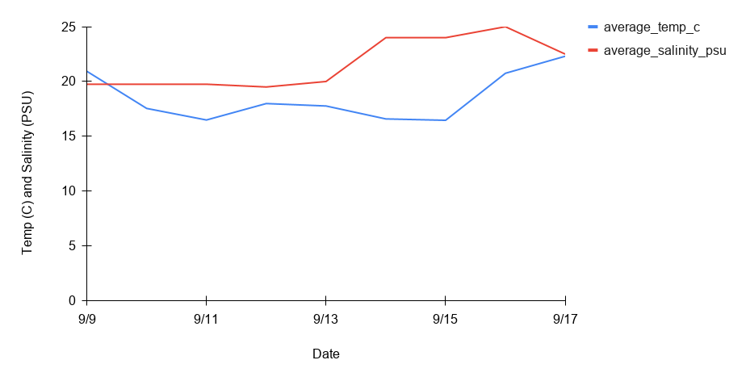
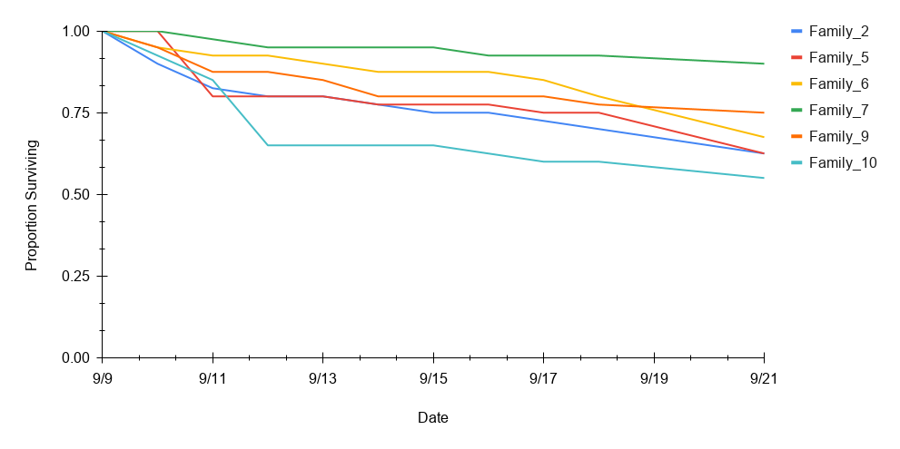

Summary details of the Oyster Family Mortality project. 

# Background information

Steven was given bags of oysters from different families from the USDA. 

We put the families into tanks in the [SHORE](https://ftr210.online/) room.

Each level (levels 1 through 4, with level 1 being at the top of the rack and level 4 at the bottom) had 6 tanks, each one containing n=10 of the families 2, 5, 6, 7, 9, 10. 

The tanks were set up on 9/9/2026. Each tank had a tube that was a water input (~20-25ppt; ~17-21 C), and the water flowed into tubing that was cycled back into a holding tank where it was then filtered and recirculated. The water was mixed using instant ocean and filtered through a sand filter system. 

  

# Daily Checks

As stated above, the family tank setup in the SHORE room was set up on 9/9/2026. I checked each tank for mortalities every day and removed them from the tank. An oyster was dead if it was gaping and did not respond to a shell touch. There were a few days I was unable to do so, and so Chris Mantegna and B Roberts did the checks those days! I also checked the salinity and temperature of one random tank at each level and logged that information. 

[Temp and salinity log](https://docs.google.com/spreadsheets/d/1dLh7vxi2xADVpf8xJWOAT4lVLNw9EDFa2lV6AG3jFKo/edit?usp=sharing)     

[Survival/Mortality log](https://docs.google.com/spreadsheets/d/1t-kk9bqcTaQnzZ45wAmJMQ0EBh7wmi6O0cTCFS4XFDw/edit?usp=sharing) 

# Results 

Temp and Salinity notes --> there were a few times where the entire system accidentally got drained. Once was when the tube that circulates th effluent through the holding tank and then through filter popped out and drained onto the floor. Another time was when there was a leak somewhere and it drained. Those times, I had to mix up new seawater with instant ocean, and that's part of why the salinity changes as the tank was never fully drained, so different salinities were getting mixed up together.

     

**Figure 1**. Temperature (C) and salinity (PSU) values averaged across all four levels over the course of the experiment. Temperature is shown in blue and salinity is shown in red. The PSU and degrees C all fell within 0-25 of each unit type, which is why there's only one y-axis. 

 

**Figure 2**. Survival plot of the six families over time. The families are color-coded according to the legend to the right. The proportion of the family surviving over time is shown. 

# Notes   

[My notebook log link](https://grace-ac.github.io/oyster-wetlab-setup-mortchecks/)      

[B Roberts' notes](https://web.goodnotes.com/s/BF1IxmPoOcPTKb9QefwNfs#page-1)    
