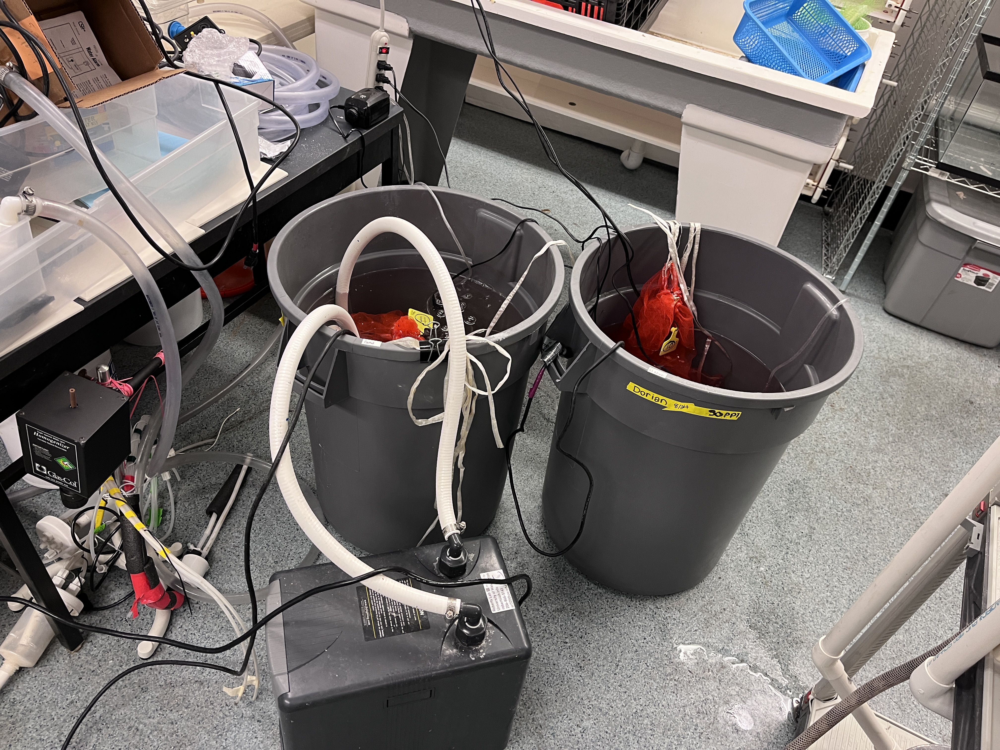
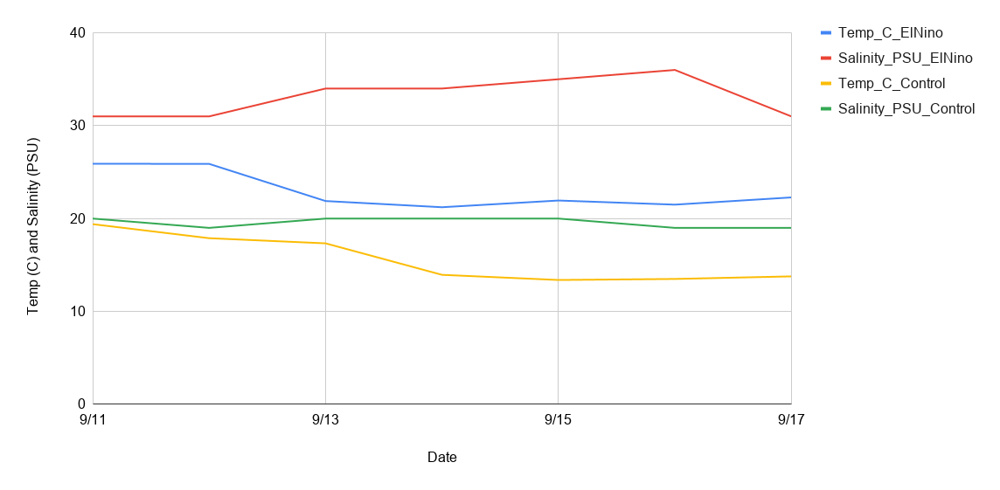
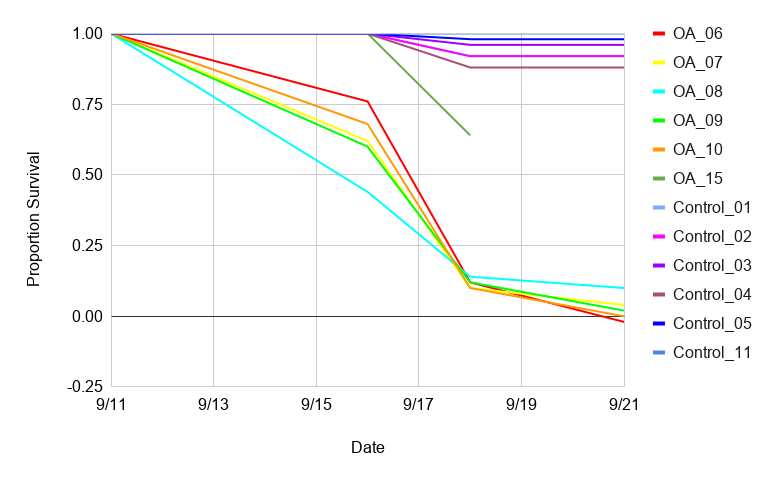

Summary info for the oyster El Niño project. 

https://genefish.wordpress.com/2026/09/18/checking-oyster-mortality-in-el-nino-experiment/ 

# El Nino Experiment Background Info 

See Ariana's post: [here](https://ahuffmyer.github.io/posts/2026-09-11-el-nino-pilot-setup.html).

Essentially, the goal for this project was to pilot the exposure of oysters to El Niño or control conditions for several days, with the eventual goal of doing this for 10 days before outplanting the oysters for a couple weeks.

The target conditions were:   

1. El Niño: 26C; 30 psu salinity; and feed 1x/week         
2. Control: 18C; 20 psu salinity; and feed 3x/week

# Experiment Set up

Ariana and Steven set up two tanks, one for each treatment, on September 11th. Within each tank, there were n=5 oyster bags, each with n=50 oysters. The bags were labeled with the oysters' respective family groupings. 

# Monitoring and Pilot Results

I checked the two tanks daily for salinity and temperature, and then ended up doing some mortality checks. I couldn't do a couple days, so Chris and B did those! B's results are included here and her notebook posts are linked in the "Notes" section below. As a note, the mortality checks continued to 9/21, but the salinity and temperature checks stopped on 9/17. 

## Temperature and Salinity Checks

[Temperature and salinity log spreadsheet](https://docs.google.com/spreadsheets/d/1tch8kVz8yiqR6oj9pwTHB4RDUDN6DQ9MfLTXAMCRxPY/edit?gid=0#gid=0 )         
[Mortality log](https://docs.google.com/spreadsheets/d/1tch8kVz8yiqR6oj9pwTHB4RDUDN6DQ9MfLTXAMCRxPY/edit?gid=1927145502#gid=1927145502) 

As stated above, the targets for the temperature and salinity for the two treatments were:    

1. El Niño: 26C; 30 psu salinity       
2. Control: 18C; 20 psu salinity

These levels fluctuated due to evaporation and also potential heater and chiller fluctuations. The measured temperatures and salinity are shown below (Fig. 1). 

     

**Figure 1**. Temperature (C) and salinity (PSU) recordings for the El Niño (temperature = blue; salinity = red) and Control (temperature = yellow; salinity = green) tanks from 9/11 to 9/17. The y-axis is the same for both units. 

**Figure 2**. Mortalities of the families.

The El Niño conditions resulted in a high mortality in all the families that were in that tank (**Fig. 2**). There are some numbers that look funny in the mortality counts for that (OA_06 dips below 0) but likely just a couple oyster counts off. 

# Notes

[My notebook log](https://grace-ac.github.io/oysterbucket-checks/)   

[B Roberts' Notebook post Sept 18](https://genefish.wordpress.com/2026/09/18/checking-oyster-mortality-in-el-nino-experiment/)

[B Roberts' Notebook post Sept 21](https://genefish.wordpress.com/2026/09/21/sept-21st-oyster-inventory-combining-el-nino-bags-and-resazurin-assays/)