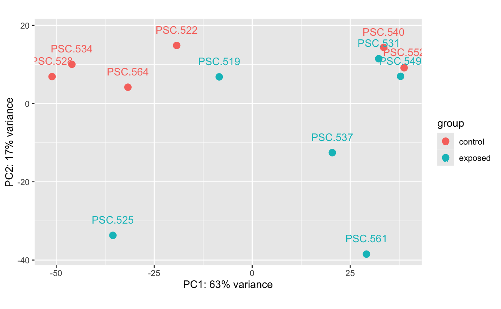
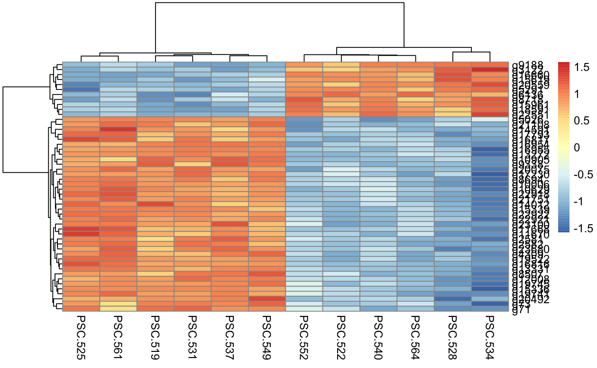
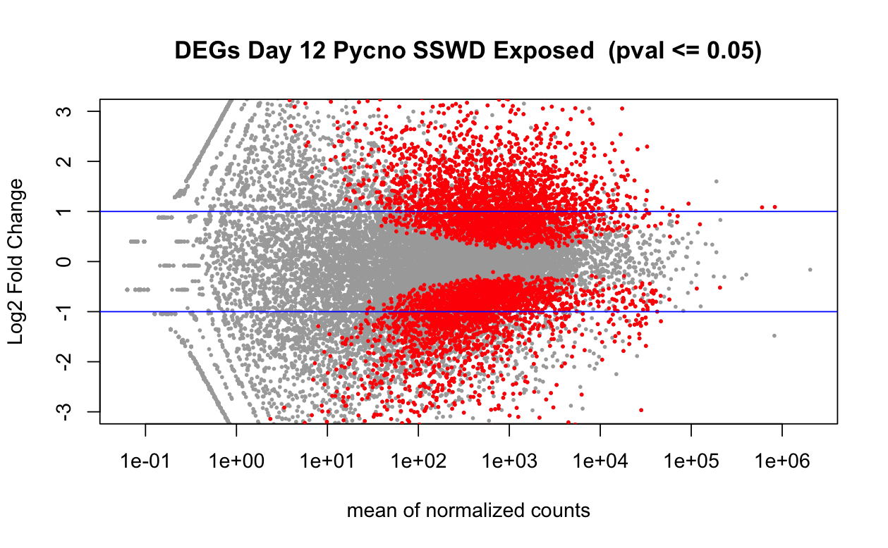
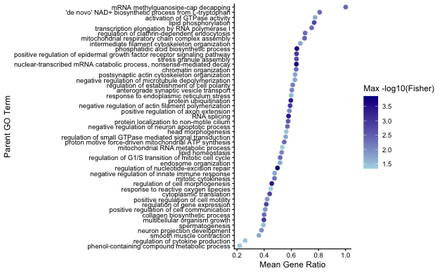
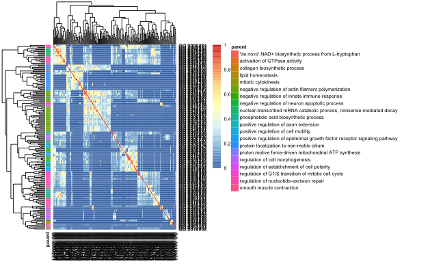
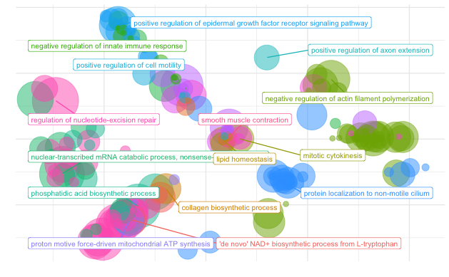
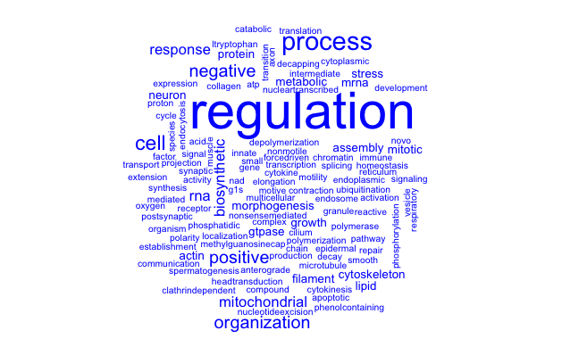

Full details of taking RNAseq data from Day 12 for _P. helianthoides_ from DEG analysis, annotation, enrichment, and result figures. 

# Background 
From the Multi-species project, I have RNAseq data from n=6 SSWD-exposed _P. helianthoides_ and n=6 control _P. helianthoides_.  The goal is to run a differential gene expression analysis using `DESeq2` with the model of `design = ~ condition`, where the comparison will be between control and SSWD-exposed sea stars. Then, annotate the DEG list with gene ontology, and get enrichment using `topGO` with the background being all the gene ontology from all the genes from the count matrix for all _P. helianthoides_ for the multi-species project. Then, use `rrvgo` and `ggplot2` to make some result plots from the enrichment. 

# Code and output: 
**NOTE**: Repository is still set to private until collaborators publish their genome. 

[github.com/grace-ac/project-pycno-multispecies-2023](https://github.com/grace-ac/project-pycno-multispecies-2023) 

Code for `DESeq2` --> `topGO` --> `rrvgo`:[code/43-pycno-D12-DESeq2-topGO.Rmd](https://github.com/grace-ac/project-pycno-multispecies-2023/blob/main/code/43-pycno-D12-DESeq2-topGO.Rmd)  

Output folder: [output/43-pycno-D12-DESeq2-topGO](https://github.com/grace-ac/project-pycno-multispecies-2023/tree/main/output/43-pycno-D12-DESeq2-topGO)

# Day 12 _P. helianthoides_ Sample Info 

Sample information: 

| Individual_star_ID | sample_ID_PSC | treatment | experiment_day | bin_number |
|--------------------|---------------|-----------|----------------|------------|
| B9_Py92            | 522           | control   | 12             | 9          |
| B10_Py86           | 528           | control   | 12             | 10         |
| B11_Py81           | 534           | control   | 12             | 11         |
| B12_Py85           | 540           | control   | 12             | 12         |
| B14_Py94           | 552           | control   | 12             | 14         |
| B16_Py95           | 564           | control   | 12             | 16         |
| B1_Py89            | 519           | exposed   | 12             | 1          |
| B2_Py83            | 525           | exposed   | 12             | 2          |
| B3_Py91            | 531           | exposed   | 12             | 3          |
| B4_Py84            | 537           | exposed   | 12             | 4          |
| B6_Py87            | 549           | exposed   | 12             | 6          |
| B8_Py26            | 561           | exposed   | 12             | 8          |

These samples at Day 12 for the exposed group are right before all exposed _P. helianthoides_ showed disease signs. As in like, a day or so before. 


# Differential Gene Expression using `DESeq2` 

Differential gene expression analysis was run using the [_P. helianthoides_ gene count matrix](https://github.com/grace-ac/project-pycno-multispecies-2023/blob/main/data/pycno_gene_count_matrix_2023.csv) for the libraries from Day 12 listed above (sample_ID_PSC). 

The analysis is run using `design = ~ condition` where condition is whether the sea star was SSWD-exposed or control. 

This resulted in a list of [5,686 DEGs](https://github.com/grace-ac/project-pycno-multispecies-2023/blob/main/output/43-pycno-D12-DESeq2-topGO/DEGlist_pycno_controlVexposed_DAY12.tab) with an adjusted p-value <0.05, [4,057 of which have gene ontology annotations](https://github.com/grace-ac/project-pycno-multispecies-2023/blob/main/output/43-pycno-D12-DESeq2-topGO/DEGlist_pycno_controlVexposed_D12_annot.tab). 

     
_Figure 1_. PCA plot of the variance transformed data 

        
_Figure 2._ Heatmap of the top 50 DEGs from the Day 12 comparison between SSWD-exposed and control _P. helianthoides_. Orange/red are higher expression and pale blues and blue are lower expression.       

       
_Figure 3._ Volcano plot of the 5,686 DEGs from the comparison of Day 12 SSWD-exposed and control _P. helianthoides_. 

# Enrichment using `topGO` 
For this process, I used a variety of resources. [Steven ran some enrichment with `topGO` using Claude](https://github.com/grace-ac/project-pycno-multispecies-2023/blob/main/code/38-degs-orth-GOenrichment.Rmd) a while back and I looked through his code, and tried it myself in [39-topGO-enrichment.Rmd](https://github.com/grace-ac/project-pycno-multispecies-2023/blob/main/code/39-topGO-enrichment.Rmd).     
I also read through a bunch of online resources:    
https://bioconductor.org/packages/release/bioc/vignettes/topGO/inst/doc/topGO_manual.R    

https://bioc.r-universe.dev/articles/topGO/topGO_manual.html 

https://nbisweden.github.io/workshop-RNAseq/1906/lab_functional.html 

https://bioconductor.posit.co/packages/3.24/bioc/vignettes/topGO/inst/doc/topGO_manual.html 

And on 2026-10-28 I met with Ariana who has done work with `topGO` and got help from her and [her code](https://github.com/AHuffmyer/larval_symbiont_TPC/blob/main/scripts/rna-seq_functional_enrichment_ASCA_topGO.Rmd).

Essentially, what the code does is:     
1. make a gene universe for the background using the gene IDs from the _P. helianthoides_ gene count matrix.    
2. Create a vector for every gene for both the background and the gene list (DEGs):  

pyc.geneList        
    0     1         
17778  5686 

3. Create a GO ID map of the background (the annotated gene count matrix)     
4. Create a `topGO` object:    
```
pyc.GOdata <- new(
    "topGOdata",
    ontology = "BP",
    allGenes = pyc.geneList, # degs 
    nodeSize = 5, #can comment out, but it removes spurious categories - trims out stuff with lower confidence in and core answer shuoldn't change
    geneSelectionFun = function(x) x,
    annot = annFUN.gene2GO, # for whole universe
    gene2GO = pyc.geneID2GO #for all the gene universe annotation
)
```     

```{r}
numSigGenes(pyc.GOdata)
sum(feasible(pyc.GOdata))
```
telling number of gene is significant out of all feasible genes      
first should be smaller than second number               
[1] 2516        
[1] 7490 

Run enrichment: 
```{r}
pyc.resultFis <- runTest(
    pyc.GOdata,
    algorithm = "weight01",
    statistic = "fisher"
)
```

Results in a table of 5,757 rows: [output/43-pycno-D12-DESeq2-topGO/pycno.D12.topGO_ALL_BP_results_nodeSize5.csv](https://github.com/grace-ac/project-pycno-multispecies-2023/blob/main/output/43-pycno-D12-DESeq2-topGO/pycno.D12.topGO_ALL_BP_results_nodeSize5.csv) 

Run a p-value adjustment:      
From Ariana's code:       
allRes$bh_adjust_weight <- p.adjust(allRes$weightFisher, method="BH") #add adjusted p-values      
BH is the benjamini hochberg correction      
```{r}
pyc.results.all$bh_adjust_weight <- p.adjust(pyc.results.all$Fisher, method="BH")
```

[output/43-pycno-D12-DESeq2-topGO/pycno.D12.topGO_ALL_BP_results_BHpval_nodeSize5.csv](https://github.com/grace-ac/project-pycno-multispecies-2023/blob/main/output/43-pycno-D12-DESeq2-topGO/pycno.D12.topGO_ALL_BP_results_BHpval_nodeSize5.csv)

next, subset the results with padj < 0.05
```{r}
p05_res <- pyc.results.all %>% dplyr::filter(Fisher < 0.05)
```

when using the nodeSize = 5, it's a list of 260 rows


```
#BiocManager::install("org.Ce.eg.db")
library(rrvgo)

#Reduce/collapse GO term set with the rrvgo package 
simMatrix <- calculateSimMatrix(p05_res$GO.ID,
                                orgdb="org.Ce.eg.db", #c. elegans database
                                ont="BP",
                                method="Rel")
```

```{r}
 #calculate similarity 
scores <- setNames(-log(as.numeric(p05_res$Fisher)), p05_res$GO.ID)
reducedTerms <- reduceSimMatrix(simMatrix,
                                scores,
                                threshold=0.7,
                                orgdb="org.Ce.eg.db")
dim(reducedTerms)
```      
[1] 177  10    

```{r}
#keep only the goterms from the reduced list
p05_res_reduced <- p05_res %>%
  filter(GO.ID %in% reducedTerms$go)

#add in parent terms to list of go terms 
p05_res_reduced$ParentTerm <- reducedTerms$parentTerm[match(p05_res_reduced$GO.ID, reducedTerms$go)]

length(unique(p05_res_reduced$ParentTerm))

p05_res_reduced <- p05_res_reduced %>% group_by(ParentTerm) %>% mutate("N_in_Parent" = dplyr::n()) %>% ungroup()
length(unique(p05_res_reduced$ParentTerm))
```      
[1] 47        
[1] 47

[output/43-pycno-D12-DESeq2-topGO/p05_reduced_GO_and_parent.csv](https://github.com/grace-ac/project-pycno-multispecies-2023/blob/main/output/43-pycno-D12-DESeq2-topGO/p05_reduced_GO_and_parent.csv)      

# Visualizations of enrichement using `rrvgo`    

         
_Figure 4._ Enriched Biological gene ontology terms for _P. helianthoides_ at day 12 comparing SSWD-exposed to control. The x-axis is the mean gene ratio, which is the number of DEGs annotated divided by the total number of genes from the gene count matrix annotated with that term. The color is that the darker blue, the more significant the Fisher p-value. 

        
_Figure 5._ Similarity matrix heatmap of Day 12 enrichment for _P. helianthoides_. The threshold was set to 0.9.

From [`rrvgo` vignette](https://bioconductor.org/packages/release/bioc/vignettes/rrvgo/inst/doc/rrvgo.html#plotting-and-interpretation):         
"`rrvgo` uses the similarity between pairs of terms to compute a distance matrix, defined as (1-simMatrix). The terms are then hierarchically clustered using complete linkage, and the tree is cut at the desired threshold, picking the term with the highest score as the representative of each group.
Therefore, higher thresholds lead to fewer groups, and the threshold should be read as the minimum similarity between group representatives."

   
_Figure 6._ Bubble plot of enriched terms for _P. helianthoides_ at Day 12... not super helpful to look at.     
 
     
_Figure 7._ Word cloud of terms that appear frequently in the enriched Biological Processes from _P. helianthoides_ at Day 12. 

Notes from [`rrvgo` vignette](https://bioconductor.org/packages/release/bioc/vignettes/rrvgo/inst/doc/rrvgo.html#plotting-and-interpretation): "Word clouds are visualizations which reproduce a text putting emphasis to words which appear frequently in a text. They can help to identify processes and functions that happen more commonly in a set of enriched GO terms, as well as comparing between different sets.""

# Notes/Questions:    
- I did not remove low-count genes from the gene matrix before running `DESeq2` --> should I?      
- For _Fig. 4_ --> would it be better if it's the Benjamini-Hochberg correct p-value shown instead of the Fisher p-value? 

Next steps:     
- go over code again and make sure it all makes sense     
- make other figures/result summaries     
- put into paper and start discussing results    


