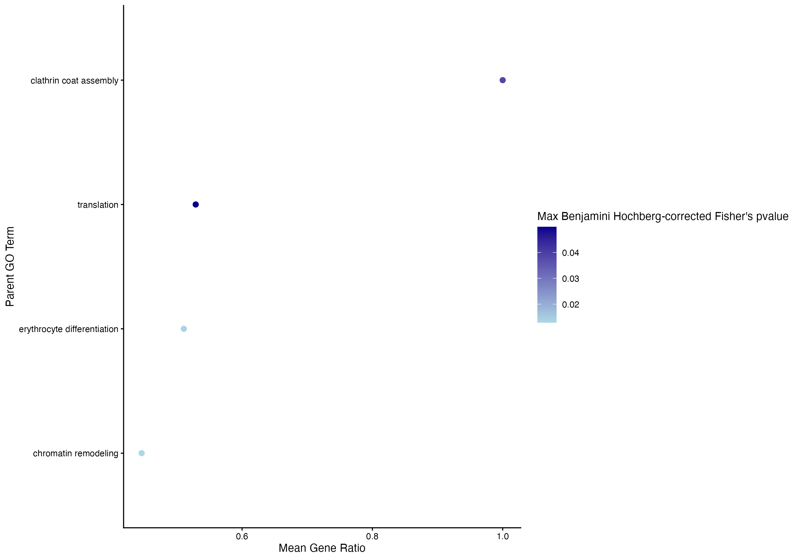
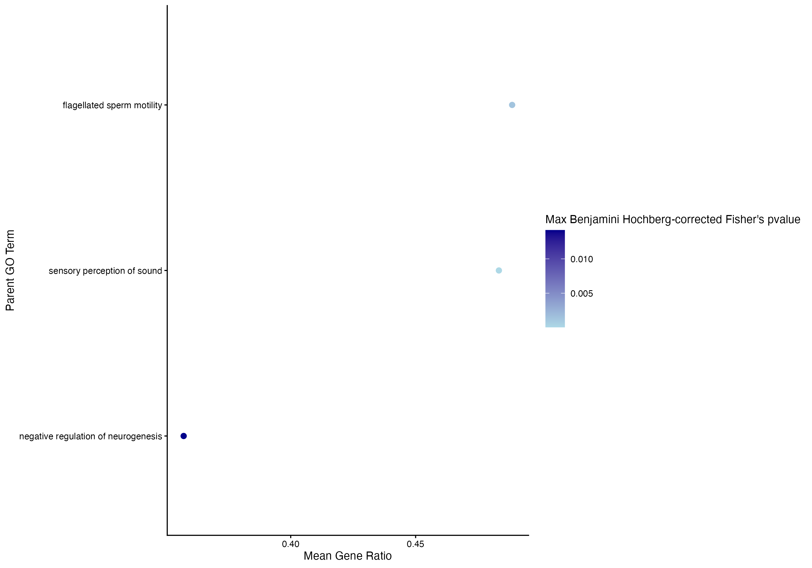
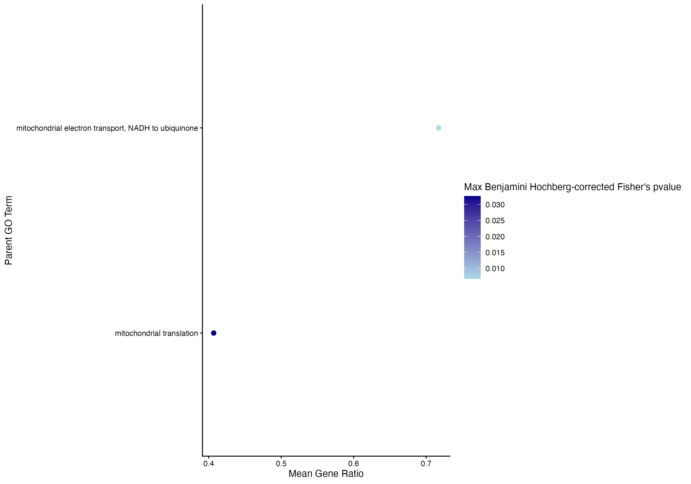

I re-ran `DESeq2` for each species excluding low count genes, and also re-made figures based on Benjamini-Hochberg-corrected p-values for all three species - details in post. 

# Previous Work 
The past week I ran `DESeq2` and enrichment using `topGO` and makde figures using `rrvgo` for all three species at Day 12 comparing SSWD-exposed and control treatments. For the previous work, I did NOT remove low-count genes, and I made figures based on the Fisher p-values. Links to those result notebook posts below:    

- [_P. helianthoides_ post](https://grace-ac.github.io/musp-pycno-day12/)      
- [_P. ochraceus_ post](https://grace-ac.github.io/pisaster-d12/)      
- [_D. imbricata_ post](https://grace-ac.github.io/derm-d12/)          

# Adjustments to previous work

Code files (**Note**: repository is private until collaborators publish their data)     
- [_P. helianthoides_](https://github.com/grace-ac/project-pycno-multispecies-2023/blob/main/code/43-pycno-D12-DESeq2-topGO.Rmd)      
- [_P. ochraceus_](https://github.com/grace-ac/project-pycno-multispecies-2023/blob/main/code/44-pisaster-D12-DESeq2-topGO.Rmd)     
- [_D. imbricata_](https://github.com/grace-ac/project-pycno-multispecies-2023/blob/main/code/45-derm-D12-DESeq2-topGO.Rmd)       

For each one, I removed low-count genes using this code:     
```
smallestGroupSize <- 6
keep <- rowSums(counts(dds) >= 10) >= smallestGroupSize
dds <- dds[keep,]
```

This is keeping those that have counts of more than 10 genes across more than 6 libraries. Each species matrix is 12 libraries, n=6 control and n=6 SSWD-exposed. 

This lead to the below DEG result files for each species:     

_P. helianthoides_    
[output/43-pycno-D12-DESeq2-topGO/DEGlist_pycno_controlVexposed_DAY12-filtered.tab](https://github.com/grace-ac/project-pycno-multispecies-2023/blob/main/output/43-pycno-D12-DESeq2-topGO/DEGlist_pycno_controlVexposed_DAY12-filtered.tab)   

[output/43-pycno-D12-DESeq2-topGO/DEGlist_pycno_controlVexposed_D12-filtered_annot.tab](https://github.com/grace-ac/project-pycno-multispecies-2023/blob/main/output/43-pycno-D12-DESeq2-topGO/DEGlist_pycno_controlVexposed_D12-filtered_annot.tab)

_P. ochraceus_      
[output/44-pisaster-D12-DESeq2-topGO/DEGlist_pisaster_controlVexposed_DAY12-filtered.ta](https://github.com/grace-ac/project-pycno-multispecies-2023/blob/main/output/44-pisaster-D12-DESeq2-topGO/DEGlist_pisaster_controlVexposed_DAY12-filtered.tab)    

[output/44-pisaster-D12-DESeq2-topGO/DEGlist_pisaster_controlVexposed_D12-filtered_annot.tab](https://github.com/grace-ac/project-pycno-multispecies-2023/blob/main/output/44-pisaster-D12-DESeq2-topGO/DEGlist_pisaster_controlVexposed_D12-filtered_annot.tab) 

_D. imbricata_     
[output/45-derm-D12-DESeq2-topGO/DEGlist_derm_controlVexposed_DAY12-filtered.tab](https://github.com/grace-ac/project-pycno-multispecies-2023/blob/main/output/45-derm-D12-DESeq2-topGO/DEGlist_derm_controlVexposed_DAY12-filtered.tab)       

[output/45-derm-D12-DESeq2-topGO/DEGlist_dermasterias_controlVexposed_D12-filtered_annot.tab](https://github.com/grace-ac/project-pycno-multispecies-2023/blob/main/output/45-derm-D12-DESeq2-topGO/DEGlist_dermasterias_controlVexposed_D12-filtered_annot.tab)

**Differences in results** 

**Table 1** Per species differences in the number of Differentially expressed genes pre and post exclusion of genes that were low counts. Genes were kept that had counts >/=10 across more than 50% of libraries.        

| Species            | Pre-low-gene-count-removal DEG # | Pre-low-gene-count-removal DEG # |
|--------------------|----------------------------------|----------------------------------|
| _P. helianthoides_ |                             5686 | 5224                             |
| _P. ochraceus_     |                             4376 | 3918                             |
| _D. imbricata_     |                             2804 | 2803                             |


And later in the enrichment plotting process, I instead plotted/sub-setting results based on the Benjamini-Hochberg-correct p-value and kept those that were <0.05. 

    
**Figure 1.** Plot of parent terms from enrichment from Day 12 DEGs for _P. helianthoides_. Color is based on the Benjamini-hochberg corrected p-value, with lighter blue being smaller value than the darker blue. All terms are <0.05 BH-corrected p-value, and thus are all significantly enriched processes. The x-axis is the gene ratio: the number of DEGs associated with that term divided by the total number of genes in the count matrix associated with that term. The larger the gene ratio, the more DEGs are associated with that term. 

      
**Figure 2.** Plot of parent terms from enrichment from Day 12 DEGs for _P. ochraceus_. Color is based on the Benjamini-hochberg corrected p-value, with lighter blue being smaller value than the darker blue. All terms are <0.05 BH-corrected p-value, and thus are all significantly enriched processes. The x-axis is the gene ratio: the number of DEGs associated with that term divided by the total number of genes in the count matrix associated with that term. The larger the gene ratio, the more DEGs are associated with that term.    

     
**Figure 3.** Plot of parent terms from enrichment from Day 12 DEGs for _D. imbricata_. Color is based on the Benjamini-hochberg corrected p-value, with lighter blue being smaller value than the darker blue. All terms are <0.05 BH-corrected p-value, and thus are all significantly enriched processes. The x-axis is the gene ratio: the number of DEGs associated with that term divided by the total number of genes in the count matrix associated with that term. The larger the gene ratio, the more DEGs are associated with that term.   


Enrichment result files for each species:     

_P.helianthoides_     

Enriched terms with BH-correct pvalue (n=5 terms have BH <0.05):        [output/43-pycno-D12-DESeq2-topGO/pycno.D12.topGO_ALL_BP_results_BHpval_nodeSize5-filtered.csv](https://github.com/grace-ac/project-pycno-multispecies-2023/blob/main/output/43-pycno-D12-DESeq2-topGO/pycno.D12.topGO_ALL_BP_results_BHpval_nodeSize5-filtered.csv)        

_P. ochraceus_      

Enriched terms with BH-correct pvalue (n=3 terms have BH <0.05):     
[output/44-pisaster-D12-DESeq2-topGO/pisaster.D12.topGO_ALL_BP_results_BHpval_nodeSize5-filtered.csv](https://github.com/grace-ac/project-pycno-multispecies-2023/blob/main/output/44-pisaster-D12-DESeq2-topGO/pisaster.D12.topGO_ALL_BP_results_BHpval_nodeSize5-filtered.csv)

_D. imbricata_      

Enriched terms with BH-correct pvalue (n=3 terms have BH <0.05):   
[output/45-derm-D12-DESeq2-topGO/dermasterias.D12.topGO_ALL_BP_results_BHpval_nodeSize5-filtered.csv](https://github.com/grace-ac/project-pycno-multispecies-2023/blob/main/output/45-derm-D12-DESeq2-topGO/dermasterias.D12.topGO_ALL_BP_results_BHpval_nodeSize5-filtered.csv)

# Differences between analyses 

## _P. helianthoides_    

**Table 2**. Table of the enriched terms from the DEG analysis that did not filter out low-count genes. These are just the terms that have BH-pval <0.05. [Result file](https://github.com/grace-ac/project-pycno-multispecies-2023/blob/main/output/43-pycno-D12-DESeq2-topGO/pycno.D12.topGO_ALL_BP_results_BHpval_nodeSize5.csv). 

| GO.ID      | Term                                        | Annotated | Significant | Expected | Fisher   | bh_adjust_weight |
|------------|---------------------------------------------|-----------|-------------|----------|----------|------------------|
| GO:0006412 | translation                                 | 295       | 156         | 99.09    | 1.50E-08 | 8.64E-05         |
| GO:0032543 | mitochondrial translation                   | 62        | 36          | 20.83    | 9.60E-06 | 0.0276336        |
| GO:0006470 | protein dephosphorylation                   | 24        | 19          | 8.06     | 1.80E-05 | 0.03022425       |
| GO:0006338 | chromatin remodeling                        | 202       | 94          | 67.85    | 2.10E-05 | 0.03022425       |
| GO:0045582 | positive regulation of T cell differenti... | 24        | 18          | 8.06     | 3.40E-05 | 0.0391476        |

**Table 3.** Table of the enriched terms from the DEG analysis that DID filter out low-count genes. These are just the terms that have BH-pval <0.05. [Result file](https://github.com/grace-ac/project-pycno-multispecies-2023/blob/main/output/43-pycno-D12-DESeq2-topGO/pycno.D12.topGO_ALL_BP_results_BHpval_nodeSize5-filtered.csv).

| GO.ID      | Term                        | Annotated | Significant | Expected | Fisher   | bh_adjust_weight |
|------------|-----------------------------|-----------|-------------|----------|----------|------------------|
| GO:0006412 | translation                 | 324       | 170         | 102.76   | 1.60E-08 | 9.58E-05         |
| GO:0006338 | chromatin remodeling        | 231       | 103         | 73.27    | 4.30E-06 | 0.0128699        |
| GO:0002181 | cytoplasmic translation     | 84        | 43          | 26.64    | 7.80E-06 | 0.0137678        |
| GO:0030218 | erythrocyte differentiation | 47        | 24          | 14.91    | 9.20E-06 | 0.0137678        |
| GO:0048268 | clathrin coat assembly      | 9         | 9           | 2.85     | 3.20E-05 | 0.0383104        |
| GO:0032543 | mitochondrial translation   | 60        | 33          | 19.03    | 5.00E-05 | 0.04988333       |

## _P. ochraceus_      

**Table 4.** Table of the enriched terms from the DEG analysis that did NOT filter out low-count genes. This is just the term that has BH-pval <0.05. [Result file](https://github.com/grace-ac/project-pycno-multispecies-2023/blob/main/output/44-pisaster-D12-DESeq2-topGO/pisaster.D12.topGO_ALL_BP_results_BHpval_nodeSize5.csv).

| GO.ID      | Term                          | Annotated | Significant | Expected | Fisher   | bh_adjust_weight |
|------------|-------------------------------|-----------|-------------|----------|----------|------------------|
| GO:0003382 | epithelial cell morphogenesis | 12        | 10          | 2.3      | 3.00E-06 | 0.016914         |


**Table 5.** Table of the enriched terms from the DEG analysis that DID filter out low-count genes. This is just the term that has BH-pval <0.05. [Result file](https://github.com/grace-ac/project-pycno-multispecies-2023/blob/main/output/44-pisaster-D12-DESeq2-topGO/pisaster.D12.topGO_ALL_BP_results_BHpval_nodeSize5-filtered.csv). 

| GO.ID      | Term                                | Annotated | Significant | Expected | Fisher   | bh_adjust_weight |
|------------|-------------------------------------|-----------|-------------|----------|----------|------------------|
| GO:0007605 | sensory perception of sound         | 60        | 29          | 11.05    | 8.80E-09 | 5.06E-05         |
| GO:0030317 | flagellated sperm motility          | 88        | 43          | 16.21    | 4.70E-07 | 0.00135102       |
| GO:0050768 | negative regulation of neurogenesis | 70        | 25          | 12.9     | 7.40E-06 | 0.01418087       |


## _D. imbricata_      

**Table 6.** Table of the enriched terms from the DEG analysis that did NOT filter out low-count genes. This is just the term that has BH-pval <0.05. [Result file](https://github.com/grace-ac/project-pycno-multispecies-2023/blob/main/output/45-derm-D12-DESeq2-topGO/dermasterias.D12.topGO_ALL_BP_results_BHpval_nodeSize5.csv).

| GO.ID      | Term                                        | Annotated | Significant | Expected | Fisher   | bh_adjust_weight |
|------------|---------------------------------------------|-----------|-------------|----------|----------|------------------|
| GO:0042776 | proton motive force-driven mitochondrial... | 18        | 14          | 3.26     | 5.70E-08 | 0.00034992       |

**Table 7.** Table of the enriched terms from the DEG analysis that DID filter out low-count genes. This is just the term that has BH-pval <0.05. [Result file](https://github.com/grace-ac/project-pycno-multispecies-2023/blob/main/output/45-derm-D12-DESeq2-topGO/dermasterias.D12.topGO_ALL_BP_results_BHpval_nodeSize5-filtered.csv).

| GO.ID      | Term                                        | Annotated | Significant | Expected | Fisher   | bh_adjust_weight |
|------------|---------------------------------------------|-----------|-------------|----------|----------|------------------|
| GO:0042776 | proton motive force-driven mitochondrial... | 16        | 12          | 2.93     | 1.20E-06 | 0.0067243        |
| GO:0006120 | mitochondrial electron transport, NADH t... | 19        | 13          | 3.48     | 2.20E-06 | 0.0067243        |
| GO:0032543 | mitochondrial translation                   | 59        | 24          | 10.8     | 1.60E-05 | 0.03260267       |


# Notes/thoughts

- I think I might re-make the enrichment plots and just show all the terms and not the parent terms since there's so few...? 

- I'm thinking that I should move forward with these newer results: i.e., the DEG lists from each species that removed low-count genes and the downstream enrichment from there --> the new results presented in this post

