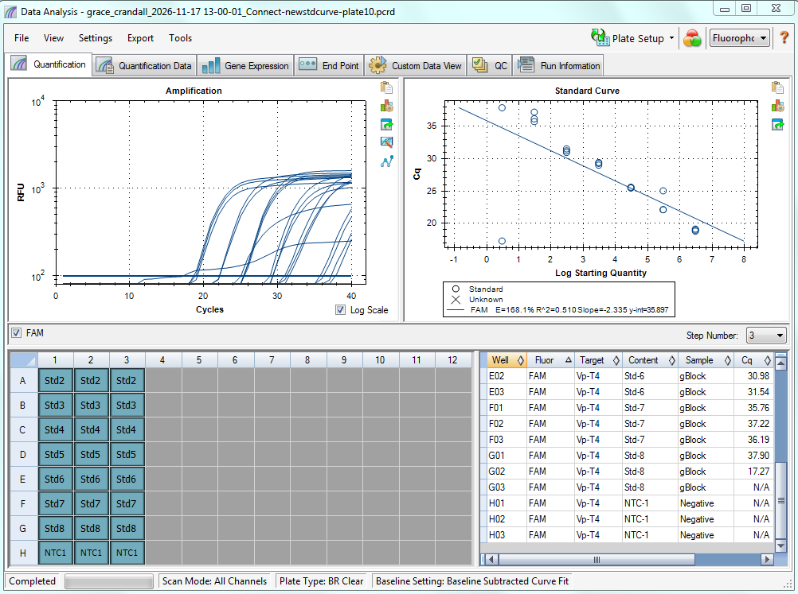
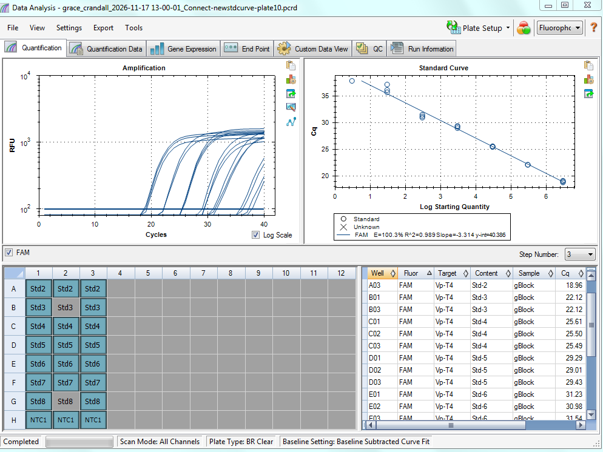
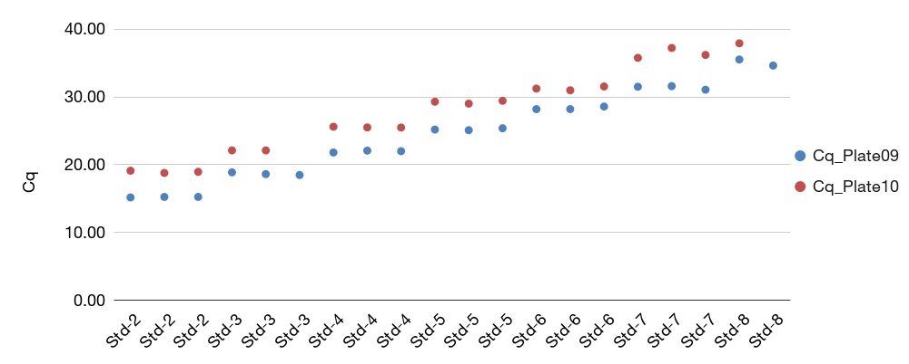

Made a new standard curve dilution. Ran just the curve to check it and compare to previous plates' curves. 

# Serial Dilution of Curve info:

See previous post: [FHL 2026 - qPCR prep and current status](https://grace-ac.github.io/qPCR-prep-updates/)

# Plate and Run info

Plate map: [here](https://docs.google.com/spreadsheets/d/1KRe3x0b3VprjWhiIOFSrioLu0Xnud9R4/edit?usp=sharing&ouid=109180173241522173082&rtpof=true&sd=true) 

Ran 3.00+06 down to 3.00+00 in the standard curve (wells A1-A3, down to G1-G3). 

I _think_ in my previous dilution, I just didn't go all the way down to 3.00+00 and only ran 3.00+07 down to 3.00+01 as my standard curve in wells A1-A3 down to G1-G3. This guess is based on the fact that when I went to make more dilutions, the last tube in the box was 3.00+08, when it should have been 3.00+07. 

## Results: 
I set the threshold to 100, as that's what I've been doing for all qPCR results. 

I had bad replication for two of my dilutions, the initial results are the first image, then the filtered results are the second image:     

      
**Figure 1.** Standard curve results on qPCR. Ran standards 3.00+06 down to 3.00+00. Set the threshold to 100. 

      
**Figure 2.**  Standard curve results on qPCR. Ran standards 3.00+06 down to 3.00+00. Set the threshold to 100. I removed the replicates that were way off, and the curves and run stats look great. But, moving forward, I need to make sure all triplicates look good. 

I also did a comparison of the Cq values from this plate to a previous plate that used the previous dilution of the standard curve... and it appears that my assumptions are correct: I was using 3.00+07, 3.00+06, 3.00+05, 3.00+04, 3.00+03, 3.00+02, and 3.00+01 for my standard curve. 

      
**Figure 3.** Cq values of the standard curve for plate 9 (previous standard curve that was used for all previous qPCR runs) and plate 10 (the new serial dilution of the standard curve started from 3.00+08 from the previous standard curve). This is showing that in all previous plates, my standard curve was actually 3.00+07 down to 3.00+01, not 3.00+06 down to 3.00+00. 

Questions:   

Moving forward, can I then just use 3.00+07--> 3.00+01 for my standard curve to keep it all consistent? 

Would I have to re-adjust all previous plates to say that the standard curve was actually 3.00+07--> 3.00+01? 

